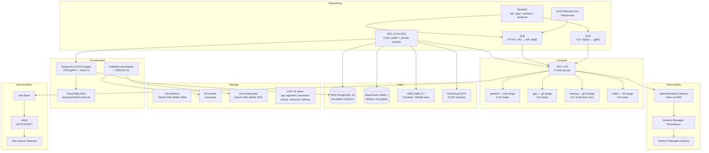
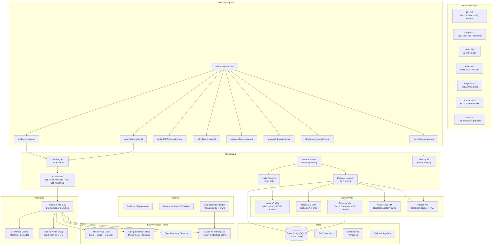

# FleetOS

A distributed robot fleet management platform that connects simulated humanoid robots to the cloud via gRPC/Kafka, exposes developer-facing REST/WebSocket APIs with auth and billing, serves AI inference through SB3 PPO policies, and provides full-stack analytics via Spark + ClickHouse.

## Repository Structure

```
robot-fleet/
├── platform/               # Cloud brain (Go backend, infra, SDKs)
│   ├── cmd/                # Entry points (api, ingestion, processor, worker, fleetos CLI)
│   ├── internal/           # Core Go packages (api, service, store, auth, billing, temporal)
│   ├── inference/          # SB3 PPO inference server + FAISS command resolution (Python)
│   ├── admin-web/          # React admin console (tenant & API key management)
│   ├── deploy/             # Docker, Helm, Terraform configs
│   ├── analytics/          # Spark + ClickHouse analytics pipeline
│   ├── migrations/         # PostgreSQL DDL migrations (001-010)
│   ├── observability/      # Prometheus, Grafana, alerting
│   ├── sdk/                # Python + TypeScript SDKs
│   ├── training/           # Offline CQL from fleet data (pipeline) + PPO/SAC/BC/autoencoder scripts
│   └── docker-compose.yml  # Full platform stack (17 services)
└── playground/             # Robot simulator (MuJoCo + React 3D)
    ├── simulator/          # MuJoCo Humanoid-v4 physics + gRPC telemetry
    ├── web/                # React + Three.js 3D dashboard
    ├── ros2_bridge/        # ROS 2 topic bridge
    ├── proto/              # Protobuf definitions (simulator copy)
    └── docker-compose.yml  # Playground stack (3 services)
```

## Features

- **Real-time Telemetry Pipeline** — Humanoid robots stream 20-DOF joint states, LiDAR, video, and audio over gRPC into Kafka, processed into Redis (hot state) + S3 (raw storage)
- **Developer API Platform** — REST, WebSocket, and gRPC APIs with OpenAPI 3.1 spec, TypeScript + Python SDKs
- **Admin Console** — React SPA at `/admin/` for tenant management, API key lifecycle (create/revoke), and billing overview
- **Multi-tenant Auth & Billing** — JWT + OAuth2/OIDC + DB-backed API key auth, RBAC (4 roles), per-tenant rate limiting, usage metering, Temporal-based billing workflows with dunning. Robot control-plane calls (`GET /api/v1/robots/{id}/policy`) are rate-limited but never billed or blocked by a tenant's API quota, so robots keep their model when the quota runs out
- **AI Inference** — SB3 PPO/SAC policy serving with hot model swap and per-request model routing (each robot's assigned model artifact, LRU policy cache), so canary robots are really served by the canary policy
- **Learning from the Fleet (offline RL)** — The training pipeline learns from what the robots actually did, not from a simulator: snapshot fleet experience → [Katib HPO] → offline CQL-SAC (Argo Workflows or Kubeflow Trainer) → evaluate on the MuJoCo *test track* → evaluation gate → register (with data lineage) → canary deploy. Started via `POST /api/v1/training/pipelines`. MuJoCo is used for evaluation only
- **Fleet Experience Data** — Every telemetry packet carries a training context: the exact 86-dim policy observation, applied action, reward, episode id/step, and an exploration flag. The processor writes it to `s3://fleetos-telemetry/training_data/v3/…` NDJSON batches; each training run pins its data in a dataset manifest. A configurable fraction of robots (default 20%) adds exploration noise so the data isn't limited to the current policy
- **Manual (online) training tools** — PPO locomotion and SAC+HER reaching in MuJoCo (`train_locomotion.py`, `train_reach.py`, `make k3s-train`, `POST /api/v1/locomotion/jobs`) remain for bootstrapping a first policy; grasping, BC and autoencoder scripts run standalone
- **Kubeflow Integration** — Kubeflow Trainer v2 `TrainJob`s on a FleetOS `ClusterTrainingRuntime`, and Katib (TPE by default) searching offline hyperparameters (learning rate, CQL α, batch size), each trial scored on the test track; the best trial's parameters train the final model. Verified on local k3s (CPU). The AWS design (GPU node group, IRSA) is in Terraform but not verified, and Terraform does not install Trainer/Katib
- **Evaluation Gate + Canary Deployment** — Models must pass the eval gate (pass rate ≥ 0.5, reward ≤ 5% below the deployed model) to be registered or deployed; deploys roll out progressively (assign 5% → observe → 25% → 50% → 100%) via Temporal with deterministic robot selection, live success_rate comparison, and automatic rollback
- **Performance Metrics** — Reward computation (forward velocity + alive bonus - control cost), uptime tracking, fall detection — fed back to model registry for canary evaluation
- **Durable Command Pipeline** — Commands flow through Kafka into Temporal workflows with full audit trail, ack tracking via Kafka topics, and automatic retries
- **Semantic Commands** — Natural language robot control via extensible command registry (strategy pattern)
- **Model Registry** — Model lifecycle (staged → canary → deployed → archived) with S3 artifacts and per-robot model assignment
- **Edge Policy Execution** — Robots run their assigned walking policy locally every control tick (47.6 Hz, as trained) instead of asking the cloud ~10×/s with stale observations; the platform still decides which model each robot runs (`GET /api/v1/robots/{id}/policy`, canary-aware). Robots and the test track share the observation builder, scene and reward/fall rule, enforced byte-for-byte by `platform/training/test_parity.py`. Observations are egocentric (relative to the robot, version 3), and every policy carries `policy_meta.json` so robots and inference refuse a policy built for a different observation layout
- **Analytics Pipeline** — S3 (raw NDJSON) → Spark (batch) → ClickHouse (OLAP) → Redis (cache) → API
- **ROS 2 Integration** — Bridge node publishing to standard ROS 2 topics (JointState, PoseStamped, BatteryState, LaserScan)
- **Cloud-native Infrastructure** — Kubernetes, Helm, Terraform (AWS), Docker Compose, Istio service mesh (mTLS)
- **Full Observability** — Prometheus metrics, Grafana dashboards, alerting rules, OpenTelemetry tracing

## Architecture

> **Full production architecture diagrams:** [platform/docs/architecture.md](platform/docs/architecture.md) — Mermaid diagrams for system overview, telemetry flow, command pipeline, canary deployment, ML training, billing, and storage tiers.

```
┌─ Playground (Robot) ─────────────────────────────┐
│  MuJoCo Humanoid-v4 Physics Simulation           │
│    ├─ gRPC StreamTelemetry → ingestion:50051     │  (joints, pose, metrics)
│    ├─ gRPC StreamCommands ← ingestion:50051      │  (walk, wave, inference)
│    └─ HTTP :8085 /spawn, /robots                 │
│  Web UI :5173 (Three.js 3D + command feed)       │
└──────────────────────────────────────────────────┘
        │ gRPC                    │ HTTP (proxied)
┌───────┴─────────────────────────┴────────────────┐
│  Platform (Cloud Brain)                          │
│  Ingestion :50051                                │
│    ├─ Telemetry → Kafka robot.telemetry          │
│    └─ Commands ← Kafka robot.commands.dispatch   │
│  API :8080                                       │
│    ├─ REST + WebSocket + Auth + Billing           │
│    ├─ Admin Console at /admin/ (React SPA)       │
│    └─ RBAC: admin, operator, developer, viewer   │
│  Inference :8081 (SB3 PPO policy)                │
│    ├─ Per-robot model lookup                     │
│    └─ Hot model swap from S3 registry            │
│  Worker (Temporal — 5 task queues)                │
│    ├─ CommandDispatchWorkflow                    │
│    ├─ ModelDeploymentWorkflow (canary rollout)   │
│    ├─ TrainingPipelineWorkflow → Argo / Kubeflow │
│    ├─ BillingCycleWorkflow (monthly invoicing)   │
│    └─ WebhookFanoutWorkflow                      │
│  Processor → Postgres/Redis/S3/ClickHouse        │
│    ├─ Fleet experience → S3 training_data/v3/    │
│    └─ Performance metrics → model registry       │
│  Training compute (offline, from fleet data)     │
│    ├─ Argo Workflows (train → evaluate)          │
│    ├─ Kubeflow Trainer TrainJobs (fleetos-sb3)   │
│    ├─ Katib HPO (TPE, 4 trials × 2 parallel)     │
│    ├─ MuJoCo test track (evaluation only)        │
│    └─ S3 artifacts (models, datasets, evals)     │
└──────────────────────────────────────────────────┘
```

## Quick Start

### Prerequisites

- Docker & Docker Compose
- Go 1.26+ (for local development)
- Node.js 20+ (for admin console development)
- kind, kubectl, helm (for Kubernetes mode)

### Option A: Docker Compose (simplest)

```bash
./start.sh                    # Start everything
./start.sh --platform         # Platform only
./start.sh --playground       # Playground only
./start.sh down               # Stop everything
```

### Option B: Kubernetes via ArgoCD (production-like)

Platform runs on a local kind cluster managed by ArgoCD. Playground runs via Docker Compose, connecting to the platform through NodePorts. `make k8s-up` handles everything automatically — no manual port-forwards needed.

```bash
# Start platform on Kubernetes (kind + ArgoCD + Argo Workflows)
./start.sh --k8s

# Start playground separately (connects to platform via NodePorts)
cd playground && docker compose up -d

# Submit a training job on k8s (Argo Workflows DAG: train → evaluate)
cd platform && make k8s-train TASK=reach TIMESTEPS=50000

# Or train locally (faster for dev, uploads to MinIO)
cd platform/training
python3 train_locomotion.py --job-id demo --timesteps 50000 \
  --env-id FleetOS-Humanoid-v2 --s3-endpoint localhost:9000

# Verify
curl http://localhost:30880/healthz
```

#### What `make k8s-up` automates

1. Creates kind cluster with all NodePort mappings pre-configured
2. Builds all Docker images (platform services + training)
3. Loads all images into kind (platform + infra + training)
4. Installs ArgoCD, patches repo-server with host repo mount
5. Deploys FleetOS Helm chart via ArgoCD (auto-sync on git commits)
6. Installs Argo Workflows, exposes UI via NodePort, applies workflow templates
7. Prints all dashboard URLs

#### K8s Management Commands

```bash
cd platform
make k8s-status              # Pod and service status
make k8s-logs SVC=api        # Tail service logs
make k8s-sync                # Force ArgoCD re-sync after code changes
make k8s-reload SVC=api      # Rebuild image + reload into kind + restart
make k8s-train TASK=locomotion TIMESTEPS=100000  # Submit training workflow
make k8s-argocd-password     # Get ArgoCD admin password
make k8s-down                # Delete cluster
```

### Option C: k3s on Colima (lightweight, MLOps-focused)

Single-node k3s inside Colima (macOS). Runs the platform plus Argo Workflows, Kubeflow Trainer v2.3.0 and Katib v0.19.0. ArgoCD, the simulator and dashboards are off to save memory. Needs ~15 GB free disk.

```bash
cd platform
make k3s-up        # colima start --kubernetes, build images, install Argo + Kubeflow + Katib, helm install
make k3s-images    # rebuild images + restart pods
make k3s-train TASK=locomotion TIMESTEPS=20000   # manual online (MuJoCo) training, e.g. to bootstrap a policy
make k3s-down      # colima stop (MinIO data on its PVC survives)

# Collect fleet experience: run the playground against k3s and spawn robots
cd ../playground
PLATFORM_HOST=<colima-vm-ip> docker-compose -f docker-compose.yml -f docker-compose.k3s.yml up -d simulator web

# Full pipeline: snapshot fleet data → [Katib] → offline training → test-track eval → gate (→ register → canary)
curl -X POST -H 'X-API-Key: dev-key-001' http://<colima-vm-ip>:30880/api/v1/training/pipelines \
  -d '{"task_type":"locomotion","gradient_steps":5000,"use_katib":true}'
```

Dashboards are on the Colima VM IP (`colima list`): API `:30880`, Argo UI `https://…:30746`, MinIO console `:30901` (S3 API pinned to `:30900` for the playground). For the Katib UI, run `kubectl -n kubeflow port-forward svc/katib-ui 8090:80` and open http://localhost:8090/katib/.

### Access Points

| Service | Docker Compose | Kubernetes (NodePort) |
|---------|---------------|----------------------|
| Platform API | http://localhost:8080 | http://localhost:30880 |
| Admin Console | http://localhost:8080/admin/ | http://localhost:30880/admin/ |
| Playground 3D | http://localhost:5173 | http://localhost:5173 (docker-compose) |
| Inference | http://localhost:8081 | http://localhost:30081 |
| Ingestion (gRPC) | localhost:50051 | localhost:30051 |
| Simulator | http://localhost:8085 | http://localhost:8085 (docker-compose) |
| ArgoCD UI | — | http://localhost:30080 |
| Argo Workflows UI | — | https://localhost:30746 |
| Grafana | http://localhost:3000 | http://localhost:30030 (admin/admin) |
| Prometheus | http://localhost:9090 | http://localhost:30090 |
| Temporal | http://localhost:8233 | gRPC only (localhost:7233) |
| MinIO Console | http://localhost:9001 | http://localhost:30901 (fleetos/fleetos123) |

### Try It

```bash
# List robots
curl -H "X-API-Key: dev-key-001" http://localhost:8080/api/v1/robots

# Send a walk command
curl -X POST -H "X-API-Key: dev-key-001" -H "Content-Type: application/json" \
  http://localhost:8080/api/v1/robots/robot-0001/command \
  -d '{"type":"walk","params":{}}'

# Run AI inference
curl -X POST -H "X-API-Key: dev-key-001" -H "Content-Type: application/json" \
  http://localhost:8080/api/v1/inference \
  -d '{"instruction":"wave hello","robot_id":"robot-0001"}'

# Create a tenant (admin)
curl -X POST -H "X-API-Key: dev-key-001" -H "Content-Type: application/json" \
  http://localhost:8080/api/v1/admin/tenants \
  -d '{"name":"My Company","tier":"pro","billing_email":"dev@co.com"}'
```

## API Endpoints

| Method | Path | Description |
|--------|------|-------------|
| `GET` | `/healthz` | Health check |
| `GET` | `/api/v1/robots` | List robots (paginated) |
| `GET` | `/api/v1/robots/{id}` | Get robot (hot state + model assignment) |
| `POST` | `/api/v1/robots/{id}/command` | Send command → Kafka → Temporal |
| `GET` | `/api/v1/robots/{id}/commands` | Command history with audit trail |
| `GET` | `/api/v1/robots/{id}/policy` | Policy the robot should run locally (canary assignment, else deployed fleet model; 404 if none) |
| `POST` | `/api/v1/inference` | AI inference (uses robot's assigned model) |
| `GET` | `/api/v1/robots/{id}/telemetry` | Recent telemetry |
| `GET` | `/api/v1/fleet/metrics` | Aggregated fleet stats |
| `GET` | `/api/v1/usage` | Tenant usage |
| `POST` | `/api/v1/models` | Register model (staged) |
| `POST` | `/api/v1/models/{id}/deploy` | Gate + start canary rollout → `202 {workflow_id}`; `422` gate rejection (with reason), `409` not staged, `503` without Temporal |
| `POST` | `/api/v1/models/{id}/archive` | Archive model |
| `POST` | `/api/v1/agents` | Register agent; `/{id}/deploy`, `/{id}/rollback`, `/{id}/deployments` |
| `GET` | `/api/v1/deployments/{id}/stream` | Stream deployment progress |
| `POST` | `/api/v1/training/pipelines` | Start offline training pipeline `{task_type: "locomotion", gradient_steps, min_transitions, max_dataset_files, backend: argo\|kubeflow, use_katib, auto_deploy}` → `202 {workflow_id, job_id}` |
| `GET` | `/api/v1/training/pipelines/{id}` | Pipeline status (`running`/`completed`/`failed`) + result (phase incl. `insufficient_data`/`gated`, dataset manifest) |
| `POST` | `/api/v1/locomotion/jobs` | Submit a single manual online (MuJoCo) Argo training job (also `GET` list/detail); `503` if training not configured |
| `POST` | `/api/v1/locomotion/evals` | Submit evaluation (also `GET` list/detail) |
| `GET` | `/api/v1/skills` | Skills catalog |
| `POST` | `/api/v1/safety/incidents` | Report safety incident (also `GET` list) |
| `POST` | `/api/v1/webhooks` | Register webhook (also `GET`, `DELETE`) |
| `GET` | `/api/v1/analytics/fleet` | ClickHouse fleet analytics (also `/robots/{id}`, `/anomalies`; when enabled) |
| `GET` | `/api/v1/billing/invoices` | Billing invoices |
| `PUT` | `/api/v1/billing/subscription/tier` | Change pricing tier |
| `POST` | `/api/v1/admin/tenants` | Create tenant + API key (admin) |
| `POST` | `/api/v1/admin/tenants/{id}/keys` | Generate API key (admin) |
| `GET` | `/api/v1/ws/telemetry` | WebSocket real-time stream |

### Authentication

- **API Key**: `X-API-Key` header (DB-backed with SHA-256 hashing)
- **JWT Bearer**: `Authorization: Bearer <token>` (HS256)
- **OAuth2/OIDC**: Bearer token validated against issuer's JWKS

Dev keys: `dev-key-001` (admin/enterprise), `dev-key-002` (viewer/free)

## Data Flow

### Command Pipeline (Kafka, no Redis pub/sub)
```
API → Kafka robot.commands → Processor → Temporal CommandDispatchWorkflow
  → Kafka robot.commands.dispatch (keyed by robot_id)
  → Ingestion CommandDispatcher → gRPC stream to robot
  → Robot executes → Kafka robot.command-acks
  → Worker AckBridge → signals Temporal workflow → audit finalized
```

### Model Deployment (Canary)
```
Register model (staged) → Deploy → Temporal ModelDeploymentWorkflow
  → StartCanary (validate, find baseline)
  → ExpandRollout 5% (fnv32(robot_id) % 100 < 5 → assign model)
  → 5 min observe → CompareCanaryMetrics (success_rate from robot uptime)
  → ExpandRollout 25% → observe → 50% → observe
  → FinalizeDeployment (100% of fleet, archive baseline)
  OR → RollbackModel (reassign affected robots to baseline)
```

### Billing Cycle
```
Tenant created → Temporal BillingCycleWorkflow (monthly, continue-as-new)
  → Every 6h: AggregateUsage (Redis counters → Postgres usage_daily)
  → Month end: GenerateInvoice → FinalizeInvoice → ProcessPayment
  → Payment failed: dunning loop (3 retries, 3-day intervals)
  → Signals: change-tier, cancel-subscription, retry-payment
```

### ML Training Pipeline (offline, from fleet experience)
```
POST /api/v1/training/pipelines → Temporal TrainingPipelineWorkflow (queue fleetos-training)
  ├─ SnapshotDataset — list s3://fleetos-telemetry/training_data/v3/, keep the newest
  │     max_dataset_files batches, require min_transitions (default 1000), write
  │     datasets/<job>/manifest.json (models bucket). Too little data → phase "insufficient_data"
  ├─ [use_katib] RunHyperparameterSearch — Katib Experiment (TPE, 4 trials × 2 parallel) over
  │     learning_rate / cql_alpha / batch_size; each trial = 2,000 offline updates on the
  │     snapshot + 5 MuJoCo test-track episodes → eval_mean_reward (maximized)
  ├─ SubmitTrainingRun — offline CQL-SAC on the snapshot (train_offline.py, raw observations,
  │     no simulator) → training/<job>/policy.zip, then evaluate on the MuJoCo test track
  │     (FleetOS-Humanoid-v2) → evaluations/<job>/eval_results.json:
  │       backend=argo      → Argo WorkflowTemplate fleetos-offline-training
  │       backend=kubeflow  → Kubeflow Trainer TrainJobs on runtime fleetos-sb3
  │                           (Katib's best params passed to the final run)
  ├─ EvaluateTrainedModel — gate: eval pass rate ≥ 0.5 and reward ≤ 5% below deployed model
  ├─ RegisterTrainedModel — registry (staged, model cql-fleet, algorithm cql-sac) with eval
  │     metrics, backend, hyperparameters and data lineage (dataset_manifest, dataset_files)
  └─ [auto_deploy] child ModelDeploymentWorkflow (canary rollout, deployment queue)

Trigger: POST /api/v1/training/pipelines. (RetrainingMonitorWorkflow, which retrains
when success_rate drops, is registered on the worker but nothing starts it yet.)

Other training scripts (platform/training/, run manually — not part of the pipeline):
  - Online RL in MuJoCo: PPO (train_locomotion.py), SAC+HER (train_reach.py, train_grasp.py)
    — e.g. to bootstrap a first policy that walks, so fleet data becomes useful
  - Supervised: behavior cloning; Unsupervised: autoencoder (86→32-dim)
```

Verified on local k3s (CPU, Argo backend): 6 simulated robots produced v2 records; a pipeline
run snapshotted 300 batches → 29,480 transitions (0 legacy, 5 unlinked dropped), ran 5,000 CQL
updates in 149 s and was gated (test-track pass rate 0%). The Katib + Kubeflow variant was
verified on the same snapshot (4 offline trials → best params → train/eval TrainJobs → gated).
Both rejections are expected, since the fleet's data was idle/falling behaviour from a
barely-trained policy.

**Trade-offs (measured, not assumed):** offline training is *not* cheaper per update. On the same
3,200 gradient updates (2–4 CPU pod, simulator running on the same VM) online PPO took 51 s and
offline CQL 100 s — CQL trains an actor plus twin critics with a conservative penalty. Its benefits
are elsewhere: it learns from what robots actually did (no sim-to-real gap), one dataset is reused
by every run and Katib trial, and every model records the exact data it was trained on. Costs move
to the data path (larger telemetry, storage) and to heavier updates.

**Limits:** offline RL can't get much better than the fleet's own behaviour, so data quality and
exploration bound it (a walking bootstrap policy from manual online training makes fleet data
useful); evaluation still needs MuJoCo; rewards are computed by the simulator (real robots would
need rewards derived from telemetry); snapshots list the whole `training_data/v3/` prefix (fine
locally, needs date-range filtering at fleet scale).

### RL Feedback Loop (Closed)
```
Robots run (simulation today)
  → Simulator computes reward per step (forward_vel + alive - ctrl_cost); a configurable
    fraction of robots (EXPLORATION_FRACTION, default 0.2) adds exploration noise
  → Telemetry training context: exact 86-dim observation, applied action, reward,
    episode_id/step, exploration flag → Kafka → Processor
  → Processor → s3://fleetos-telemetry/training_data/v3/YYYY/MM/DD/HH/<robot>/transitions_*.ndjson
  → Processor aggregates uptime → model registry success_rate
                                                    ↓
  POST /api/v1/training/pipelines (success_rate monitor designed, not started yet)
  → Offline CQL-SAC on a pinned snapshot of fleet experience (Argo or Kubeflow)
  → Evaluated on the MuJoCo test track; gate rejects models that don't clear the
    pass rate / baseline
  → New policy uploaded to S3 → registered as staged (with its dataset manifest)
  → Canary deploy: assign 5% → observe → 25% → 50% → 100% (with auto-rollback)
  → Robots get new inference_model_id → API inference requests are routed to that artifact
    (the simulator still calls inference directly and gets the fleet-wide active model)
  → The new policy's behaviour becomes the next dataset → loop continues
```

## Testing

```bash
cd platform
go test -race ./internal/... ./test/...
```

## Tech Stack

| Layer | Technologies |
|-------|-------------|
| Backend | Go 1.26, gRPC, Protocol Buffers, net/http |
| Frontend | React 19, TypeScript, Three.js, Vite |
| Orchestration | Temporal (commands, deployments, training pipeline, billing, webhooks) |
| ML Training | Offline RL (CQL-SAC) from fleet experience; Argo Workflows, Kubeflow Trainer v2 (TrainJob), Katib HPO; SB3 PPO/SAC for manual online training, behavior cloning, autoencoder |
| ML Compute | CPU on local k3s (verified); AWS design: GPU nodes (g5.2xlarge, scale-from-zero), IRSA for S3 (not verified) |
| AI/ML | Python, SB3, sb3-contrib, PyTorch, MuJoCo (simulation + evaluation), FAISS |
| Messaging | Kafka (telemetry, commands, acks, deployment events) |
| Storage | PostgreSQL 16, Redis 7, MinIO (S3), ClickHouse |
| Analytics | Apache Spark, ClickHouse (OLAP) |
| API | REST, WebSocket, OpenAPI 3.1, OAuth2/OIDC, JWT |
| SDKs | TypeScript, Python |
| Robotics | MuJoCo physics, ROS 2 (Humble) |
| Infrastructure | Kubernetes, Docker, Helm, Terraform (AWS + OpenStack), Istio |
| Observability | Prometheus, Grafana, OpenTelemetry |

## Infrastructure (Terraform)

FleetOS supports deployment on both **AWS** and **OpenStack**. Terraform configs live in `platform/deploy/terraform/` (AWS) and `platform/deploy/terraform/openstack/` (OpenStack).

### AWS



### OpenStack



### Resource Comparison

| Component | AWS | OpenStack |
|-----------|-----|-----------|
| Kubernetes | EKS (managed) | Magnum |
| Database | RDS PostgreSQL 16 | Trove PostgreSQL 16 |
| Cache | ElastiCache Redis 7 | Compute VMs + userdata |
| Message Broker | MSK Kafka 3.7 | Compute VMs + KRaft + Cinder |
| Object Storage | S3 (encrypted, lifecycle) | Swift (versioned) |
| Container Registry | ECR (6 repos) | Harbor VM |
| Workflow Engine | Temporal on ECS Fargate | Temporal on Compute VM |
| Analytics OLAP | ClickHouse on EC2 | ClickHouse on Compute VM |
| Load Balancer | ALB + NLB | Octavia |
| DNS | Route53 | Designate |
| TLS Certificates | ACM | Manual / Barbican |
| Secrets | Secrets Manager | Barbican |
| Monitoring | Amazon Managed Prometheus + Grafana | kube-prometheus-stack (Helm) |
| Tracing | OTEL Collector → AMP | OTEL Collector (Helm) |
| Service Mesh | Istio (Helm) | Istio (Helm) |

## Contributing

Contributions are welcome. See [CONTRIBUTING.md](CONTRIBUTING.md) for setup, tests and conventions,
and [open issues](https://github.com/deBilla/robot-fleet/issues) for places to start
(`good first issue`, `help wanted`).

## License

[MIT](LICENSE)
